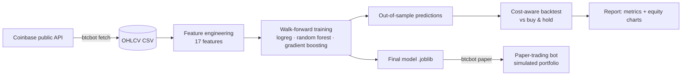
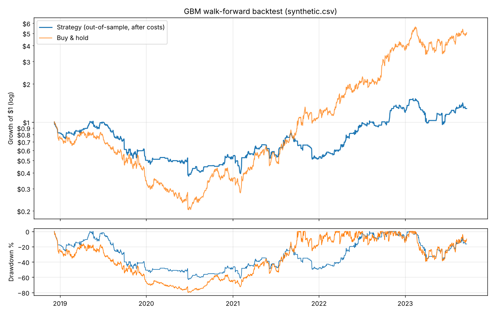

# btc-trading-bot

**🌐 Live dashboard: https://chiru-6.github.io/btc-trading-bot/**


A machine-learning research bot for Bitcoin. It downloads market data, engineers features, trains classifiers with **walk-forward validation**, backtests them **after fees and slippage**, and runs the winner as a **paper-trading bot**.

The point of the project is to measure honestly whether a model has an edge, not to promise one. Most of the code exists to stop the usual ways backtests lie: lookahead bias, train/test leakage, ignored trading costs and in-sample "live" tests.

> ⚠️ Educational project. It never places real orders and is not financial advice.

---

## How it works



| Stage | What it does | File |
|---|---|---|
| Data | Pages through Coinbase's public candles API (300 per request, rate-limit backoff, drops the still-forming candle). Can also generate synthetic regime-switching data for offline runs. | `data.py` |
| Features | Multi-horizon momentum, volatility and vol-regime, distance from 10/50/200 SMAs, RSI, MACD histogram, candle shape, volume z-score, drawdown from the 90-period high. | `features.py` |
| Labels | `1` if the log return over the next *h* candles is above a threshold. | `features.py` |
| Training | Expanding-window walk-forward with an **embargo** equal to the label horizon, so no training label overlaps the test period. | `model.py` |
| Signals | Go long when `P(up) ≥ 0.55` and flat when `P(up) < 0.50`. The gap (hysteresis) stops fee-burning flip-flops. | `backtest.py` |
| Backtest | A position decided at the close of *t* earns the return from *t* to *t+1*. Fees and slippage are charged on every position change. Reports CAGR, Sharpe, Sortino, max drawdown, trade count, win rate and exposure. | `backtest.py` |
| Paper trading | Loads the model, scores the newest closed candle, updates a JSON portfolio and appends to a trade log. Safe to run repeatedly (idempotent per candle). | `paper.py` |

## Guardrails against fooling yourself

- **No-lookahead test.** `tests/test_features.py` rebuilds features on truncated data and on data with the future deliberately corrupted, and asserts that past feature values never change.
- **Embargoed walk-forward.** Every prediction in the backtest comes from a model that never saw that period.
- **Costs included.** 10 bps fee plus 5 bps slippage per side by default. Both are configurable.
- **True holdout for paper replay.** `train --holdout N` keeps the newest *N* candles completely unseen. `paper --replay N` then simulates live trading on them. The bot warns you if a replay overlaps the training data.
- **Buy-and-hold benchmark** sits next to every result. A strategy that can't beat holding isn't worth running.
- **Selection-bias warning.** Picking the best of several models on the same test data inflates its score, and the CLI says so.

## Quickstart

```bash
git clone https://github.com/chiru-6/btc-trading-bot.git
cd btc-trading-bot
python -m venv .venv && source .venv/bin/activate   # Windows: .venv\Scripts\activate
pip install -e ".[dev]"
pytest -q                                            # 11 tests
```

### 1. Get data

```bash
btcbot fetch --granularity 1d --days 3650 --out data/btc_1d.csv   # real BTC-USD daily candles
# or, offline:
btcbot synth --out data/synthetic.csv
```

### 2. Train and backtest

```bash
btcbot train --data data/btc_1d.csv --model all --holdout 180 --name btc-daily
```

This trains all three models walk-forward, prints a comparison table, writes charts and metrics to `reports/btc-daily/`, and saves the best model (retrained on all non-holdout data) to `models/model.joblib`.

Useful flags: `--horizon 3` predicts 3 candles ahead. `--threshold 0.002` only counts moves above 0.2% as "up". `--enter/--exit` tune the signal thresholds. `--fee-bps/--slippage-bps` set costs.

### 3. Paper trade

```bash
# Honest replay on the 180 held-out candles
btcbot paper --data data/btc_1d.csv --replay 180

# Live paper trading: fetch the latest candles, act on the newest closed one
btcbot paper
```

To run it live every day, schedule `btcbot paper` with cron (or Task Scheduler on Windows) shortly after 00:00 UTC, when the daily candle closes:

```
5 0 * * *  cd /path/to/btc-trading-bot && .venv/bin/btcbot paper >> paper/cron.log 2>&1
```

## Live paper trading (runs itself on GitHub)

`.github/workflows/live-paper-trading.yml` runs every day at 00:15 UTC, right after the daily candle closes. It:

1. fetches fresh BTC-USD candles,
2. **retrains the model every Sunday** on all data up to that day (or on first run, or on demand),
3. paper-trades the newest candle with a simulated $1,000 account,
4. commits the updated account, trade log and chart to [`live/`](live/),
5. rebuilds the **[live dashboard website](https://chiru-6.github.io/btc-trading-bot/)** on GitHub Pages.

Everything the bot does after its first training day is genuinely out-of-sample. **[→ Current live status](live/README.md)**

**Setup (one time):**
1. **Settings → Actions → General → Workflow permissions:** choose **Read and write permissions**.
2. **Settings → Pages → Build and deployment → Source:** choose **GitHub Actions**.
3. **Actions → Live paper trading → Run workflow** to start it immediately.

Build the site locally with `btcbot site` and preview it with `python -m http.server -d _site`.

**Running locally instead (Windows):** `run_daily.ps1` does the same thing on your PC. See the comments at the top of the script for the one-line Task Scheduler setup.

## Sample results (synthetic data)

This output comes from `reports/sample/`, generated on **synthetic** data so the repo runs out of the box. Replace it with your real BTC run.

| model | total return | CAGR | Sharpe | max DD | trades | mean AUC |
|---|---:|---:|---:|---:|---:|---:|
| logistic regression | −25.9% | −6.1% | 0.01 | −68% | 90 | 0.48 |
| random forest | −20.2% | −4.6% | 0.03 | −58% | 95 | 0.50 |
| gradient boosting | +28.0% | +5.3% | 0.34 | −63% | 255 | 0.51 |
| **buy & hold** | **+406.6%** | **+40.4%** | **0.89** | −80% | – | – |



**Takeaway:** out-of-sample AUC is about 0.50, meaning the models are close to coin flips, and none beat buy-and-hold after costs. The ML strategies did cut the worst drawdown. That is the expected and *correct* result on noisy data. A pipeline that showed huge profits here would point to a leakage bug.

## Project structure

```
src/btcbot/
  data.py       # Coinbase fetcher, synthetic generator, CSV I/O
  features.py   # indicators + labels (lookahead-free)
  model.py      # model zoo + embargoed walk-forward
  backtest.py   # signals, cost-aware backtest, metrics
  paper.py      # simulated live trading
  report.py     # charts + comparison tables
  site.py       # builds the GitHub Pages dashboard (data.json + web/index.html)
  cli.py        # `btcbot` command
tests/          # no-lookahead, backtest math, walk-forward, end-to-end
.github/workflows/ci.yml   # pytest + CLI smoke test on every push
```

## Roadmap

- [ ] Hyperparameter search *inside* each walk-forward fold (nested CV)
- [ ] Volatility-targeted position sizing instead of all-in/all-out
- [ ] Hourly data and intraday features
- [ ] On-chain and funding-rate features
- [ ] Probability calibration and a confidence-weighted position size
- [ ] Streamlit dashboard for the paper-trading log

## License

MIT
