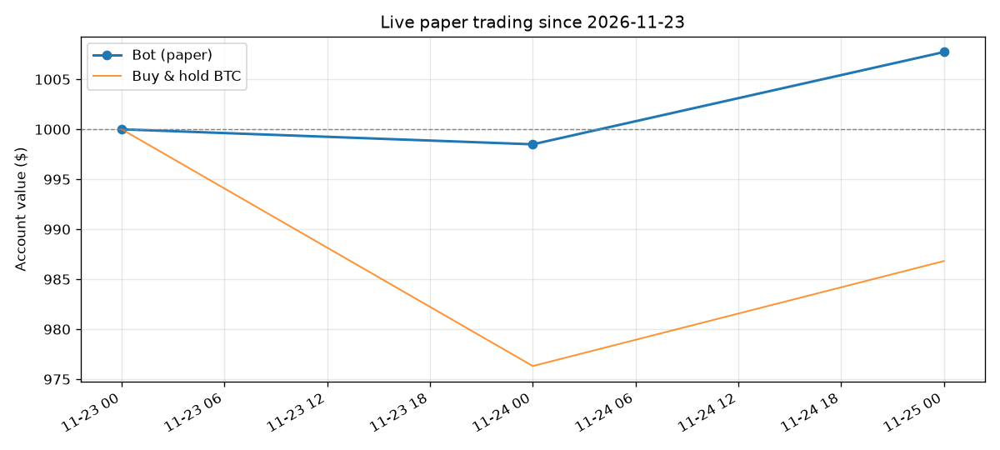

# Live paper-trading status

_Updated automatically by GitHub Actions. Last candle: 2026-11-25 00:00:00+00:00_

| | Bot | Buy & hold |
|---|---:|---:|
| Account value | $1,007.73 | $986.82 |
| Return | +0.77% | -1.32% |

- Running since **2026-11-23** (3 daily candles)
- Current position: **CASH** (latest P(up) = 0.476)
- Trades so far: **2**

Simulated $1,000 account, 10 bps fee + 5 bps slippage per trade. No real money.
